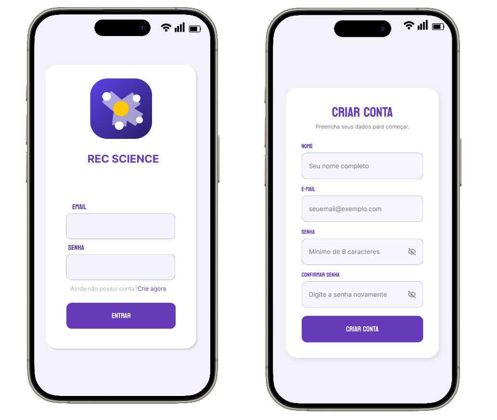
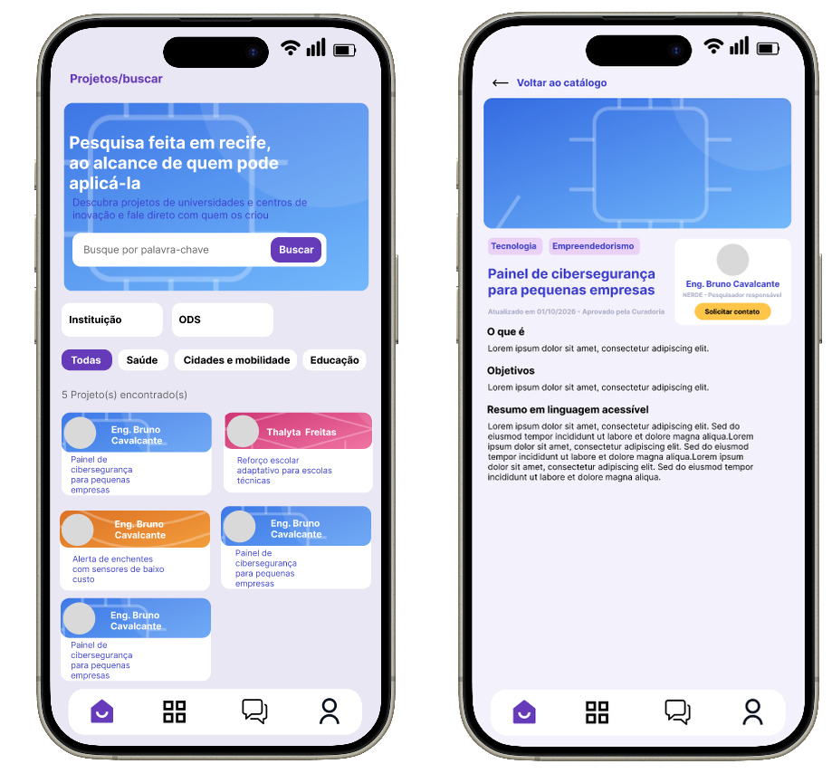
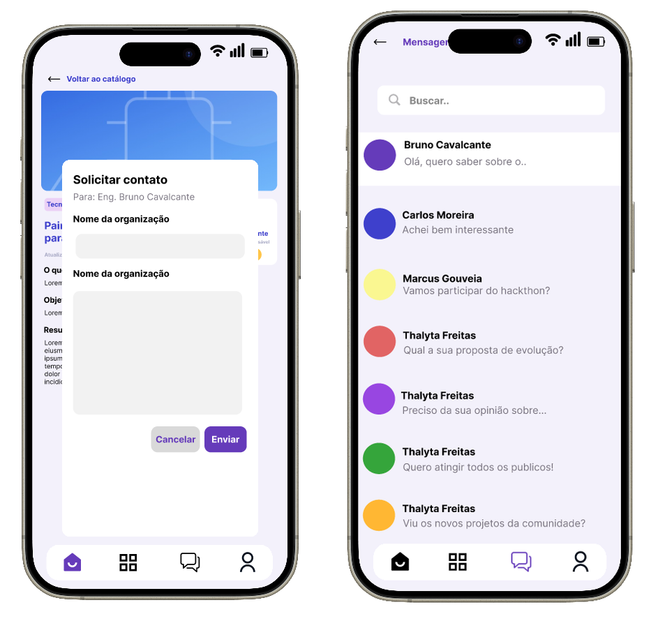
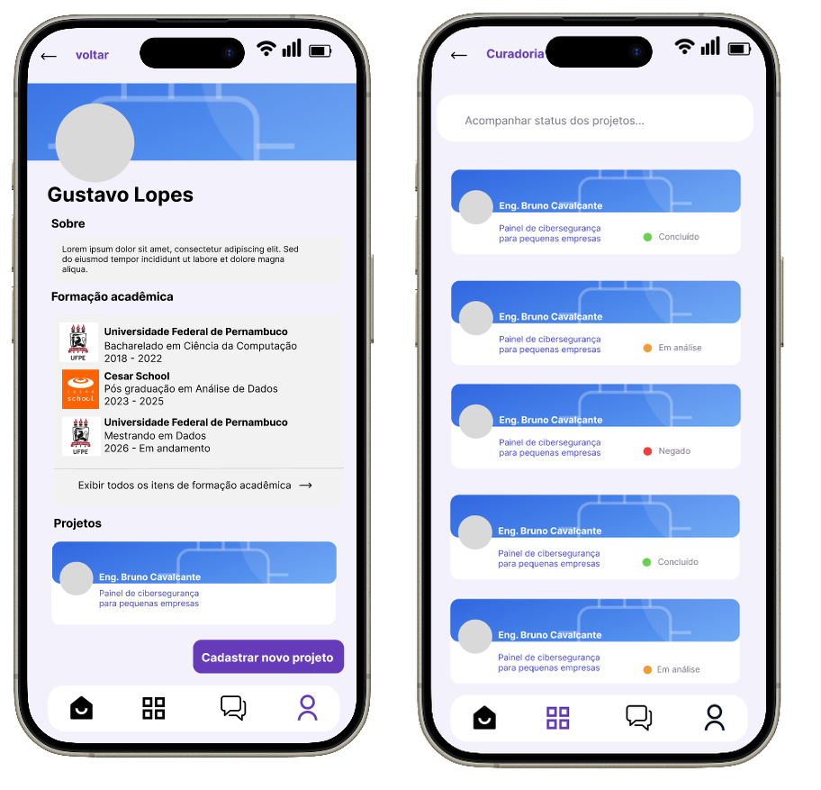

# Hub de Inovação e Pesquisa de Recife

Projeto Integrador do curso de **Análise e Desenvolvimento de Sistemas**, desenvolvido a partir de um desafio do [Banco de Oportunidades da Prefeitura do Recife](https://bancodeoportunidades.recife.pe.gov.br/).

> **Situação do projeto:** AV1 em andamento; AV2 não iniciada. O desenvolvimento do MVP será realizado na segunda avaliação.

## Identificação da equipe

- **Turma:** 5NA
- **Grupo:** REC SCIENCE
- **Nome do projeto:** REC SCIENCE
- **BO escolhido:** Hub de Inovação e Pesquisa de Recife
- **Link do BO:** https://bancodeoportunidades.recife.pe.gov.br/

### Integrantes

| Nome | GitHub |
|---|---|
| Arnaldo Reis Leal Neto | [Arnaldoreisl](https://github.com/Arnaldoreisl) |
| Carla Rayanne da Silva | [CarlaSilva](https://github.com/CarlaSilva-Dev) |
| Gustavo Lopes de Lima | [gustavolopeslima](https://github.com/gustavolopeslima) |
| Higor Ricardo da Silva | [hiig0](https://github.com/hiig0) |
| Emilly Mayra do Santos Silva | [EmillyMayra](https://github.com/EmillyMayra) |

## Visão geral

Recife reúne universidades, institutos federais e centros de inovação que produzem pesquisas e projetos relevantes. Entretanto, essas informações ficam distribuídas entre diferentes sites e instituições, dificultando que gestores públicos, empresas, empreendedores e cidadãos encontrem e compreendam possíveis soluções.

O **Hub de Inovação e Pesquisa de Recife** propõe uma plataforma pública para reunir pesquisas e projetos em um catálogo pesquisável, com filtros por área do conhecimento, instituição, tipo de projeto e Objetivos de Desenvolvimento Sustentável (ODS). Cada projeto terá uma apresentação padronizada e acessível, além de um mecanismo para solicitar contato com os pesquisadores responsáveis.

## Problema e proposta de solução

**Problema:** a produção científica e tecnológica local tem pouca centralização e visibilidade fora do meio acadêmico. A linguagem técnica e a ausência de um canal organizado de contato dificultam possíveis parcerias e aplicações práticas.

**Solução:** disponibilizar um catálogo público de pesquisas e projetos das instituições participantes, com informações padronizadas, curadoria antes da publicação e registro das solicitações de contato.

**Público-alvo:** pesquisadores, instituições de ensino e pesquisa, empresas, órgãos públicos, empreendedores, investidores e cidadãos interessados em inovação.

### Fluxo principal previsto

```text
Pesquisador cadastra um projeto
        ↓
Curador analisa e aprova a publicação
        ↓
Interessado pesquisa e filtra os projetos
        ↓
Interessado consulta o perfil do projeto
        ↓
Interessado solicita contato
        ↓
Sistema registra a solicitação para o pesquisador responsável
```

## Funcionalidades do MVP

- Catálogo público com pesquisa por palavras-chave.
- Filtros por área do conhecimento, instituição, tipo de projeto e ODS.
- Perfil padronizado dos projetos, com resumo acessível, objetivos, aplicações e instituição responsável.
- Cadastro e atualização de projetos por pesquisadores.
- Análise e aprovação dos projetos antes da publicação (curadoria).
- Solicitação de contato com o pesquisador, com registro no sistema.
- Autenticação e controle de acesso conforme o perfil do usuário.

**Fora do escopo inicial:** importação automática de dados do Lattes/ORCID, recomendação automática de pesquisas, negociação ou financiamento pela plataforma e painel público de BI. Notificações por e-mail e indicadores básicos poderão ser incluídos se houver tempo.

## Arquitetura e tecnologias previstas

A solução foi planejada como um **monólito modular**, com uma interface web responsiva, comunicação por **API HTTP/REST** e persistência em **PostgreSQL**.

| Camada | Tecnologia ou abordagem |
|---|---|
| Frontend | HTML, CSS e JavaScript |
| Backend | Python |
| Banco de dados | PostgreSQL |
| Autenticação | JWT com controle de acesso por perfil |
| Comunicação | API HTTP/REST |
| Notificações | Serviço de e-mail e processamento em segundo plano, se incluído |
| Hospedagem | A definir conforme os recursos do MVP |

> As tecnologias acima descrevem o planejamento arquitetural da equipe, não uma implementação já concluída.

## Protótipo

[**Acessar o protótipo no Figma**](https://www.figma.com/design/3QOYNbl0Jwc72Y3NQvX92X/Untitled?node-id=0-1&t=af7AH4OgNlfhMWEu-1)

O fluxo navegável mínimo previsto é: **página inicial → busca com filtros → perfil do projeto → solicitação de contato → confirmação**.
## Protótipo do Rec Science

O protótipo apresenta as principais telas planejadas para a plataforma, demonstrando a navegação e as funcionalidades propostas.

### Login e cadastro


### Catálogo e perfil do projeto


### Solicitação de contato e mensagens


### Perfil do pesquisador e curadoria


### Protótipo navegável
[Visualizar no Figma](https://www.figma.com/design/3QOYNbl0Jwc72Y3NQvX92X/Untitled?node-id=0-1)

## Documentação

Os arquivos disponíveis no repositório organizam as entregas e o planejamento do projeto:

| Arquivo | Conteúdo |
|---|---|
| [01-problema.md](docs/01-problema.md) | Definição e delimitação do problema |
| [02-investigacao-e-evidencias.md](docs/02-investigacao-e-evidencias.md) | Investigação e evidências |
| [03-proposta-de-solucao.md](docs/03-proposta-de-solucao.md) | Proposta de solução e funcionalidades |
| [04-requisitos.md](docs/04-requisitos.md) | Requisitos funcionais, não funcionais e critérios de aceite |
| [05-arquitetura-e-tecnologias.md](docs/05-arquitetura-e-tecnologias.md) | Arquitetura e tecnologias previstas |
| [06-planejamento-do-mvp.md](docs/06-planejamento-do-mvp.md) | Escopo e planejamento do MVP |
| [checklist-av1.md](docs/checklist-av1.md) | Conferência da entrega AV1 |
| [checklist-av2.md](docs/checklist-av2.md) | Conferência da entrega AV2 |

Outros arquivos importantes: [ENTREGA.md](ENTREGA.md), para identificação das versões entregues, e [CONTRIBUTING.md](CONTRIBUTING.md), para as regras de colaboração.

## Avaliações e entregas

### AV1 — Projeto da solução

A primeira avaliação contempla a investigação do problema, a proposta de solução, os requisitos, o protótipo, a arquitetura e o planejamento do MVP.

- **Status no documento acadêmico:** em andamento.
- **Tag prevista para a entrega:** `v1.0-av1`.
- **Checklist:** [docs/checklist-av1.md](docs/checklist-av1.md).

### AV2 — MVP funcional

Na segunda avaliação, a equipe deverá implementar e validar pelo menos um fluxo principal funcional de ponta a ponta, incluindo o registro de solicitações de contato no banco de dados.

- **Status no documento acadêmico:** não iniciada.
- **Tag prevista para a entrega:** `v2.0-av2`.
- **Checklist:** [docs/checklist-av2.md](docs/checklist-av2.md).

### Como executar o projeto

As instruções abaixo executam o backend atualmente disponível em
`src/backend`. O frontend ainda não possui uma aplicação executável separada
neste repositório.

#### Pré-requisitos

- Git;
- Python 3.14 ou superior (o ambiente atualmente validado usa Python 3.14.6);
- PowerShell no Windows ou um terminal compatível no Linux/macOS.

#### 1. Obter o projeto

Caso o projeto ainda não esteja no computador:

```bash
git clone URL_DO_REPOSITORIO
cd bo-recife-grupo777-hub-de-inova-o
```

Substitua `URL_DO_REPOSITORIO` pela URL do repositório.

#### 2. Entrar na pasta do backend

```bash
cd src/backend
```

Todos os comandos de Alembic devem ser executados nessa pasta, pois o arquivo
`alembic.ini` e o diretório `alembic` ficam nela.

#### 3. Criar e ativar o ambiente virtual

No Windows PowerShell:

```powershell
py -3.14 -m venv venv
.\venv\Scripts\Activate.ps1
```

No Windows usando o Prompt de Comando:

```bat
py -3.14 -m venv venv
venv\Scripts\activate.bat
```

No Linux/macOS:

```bash
python3 -m venv venv
source venv/bin/activate
```

Se o PowerShell bloquear a ativação, execute uma vez:

```powershell
Set-ExecutionPolicy -Scope CurrentUser RemoteSigned
```

Também é possível executar os comandos usando diretamente
`venv\Scripts\python.exe`, sem ativar o ambiente.

#### 4. Instalar as dependências

Com o ambiente virtual ativado:

```bash
python -m pip install --upgrade pip
python -m pip install -r requirements.txt
```

#### 5. Configurar variáveis de ambiente

Não há variáveis obrigatórias para iniciar a aplicação atualmente. A variável
`SECRET_KEY` já é lida pelo backend e deve ser definida antes de usar recursos
de autenticação que dependam dela:

No Windows PowerShell:

```powershell
$env:SECRET_KEY = "substitua-por-uma-chave-segura"
```

No Linux/macOS:

```bash
export SECRET_KEY="substitua-por-uma-chave-segura"
```

Não versione arquivos `.env` com valores reais. Para tornar a configuração
persistente, crie um arquivo `.env` dentro de `src/backend` e mantenha-o
apenas localmente.

#### 6. Configurar e executar as migrações do banco

O projeto usa o **Alembic** para controlar a estrutura do banco de dados e
usa **SQLite** por padrão. O arquivo do banco será criado em
`src/backend/banco.db` quando a primeira migração for aplicada.

A configuração do Alembic está em `src/backend/alembic.ini`, o ambiente de
execução está em `src/backend/alembic/env.py` e os arquivos de migração ficam
em `src/backend/alembic/versions`.

##### Aplicar todas as migrações

Execute dentro de `src/backend`, com a virtualenv ativada:

```bash
python -m alembic upgrade head
```

Esse comando cria as tabelas `usuarios` e `projetos` e aplica todas as
alterações registradas até a versão mais recente.

##### Conferir a versão aplicada

```bash
python -m alembic current
```

Para listar o histórico completo:

```bash
python -m alembic history
```

Para verificar se existem alterações nos modelos que ainda não foram
registradas em uma migração:

```bash
python -m alembic check
```

O comando `check` deve ser executado depois de `upgrade head`. Se aparecer
`Target database is not up to date`, aplique primeiro:

```bash
python -m alembic upgrade head
```

##### Criar uma nova migração

Depois de alterar os modelos em `src/backend/app/models.py`, gere uma revisão
com uma mensagem descritiva:

```bash
python -m alembic revision --autogenerate -m "descrever alteracao do banco"
```

Revise o arquivo gerado em `src/backend/alembic/versions` antes de aplicá-lo.
O Alembic pode não identificar corretamente todas as alterações, por isso a
migração deve ser conferida manualmente.

Depois da revisão:

```bash
python -m alembic upgrade head
python -m alembic check
```

##### Reverter uma migração

Para voltar uma versão:

```bash
python -m alembic downgrade -1
```

Para voltar o banco ao estado inicial, antes da primeira migração:

```bash
python -m alembic downgrade base
```

Use `downgrade` com cuidado, pois ele pode remover tabelas ou colunas e causar
perda de dados.

##### Migrações existentes

Atualmente, o projeto possui:

| Revisão | Descrição |
|---|---|
| `fc4d5b8ee310` | Criação inicial das tabelas `usuarios` e `projetos` |
| `3eda222e4e8f` | Adição da coluna `descricao` em `projetos` |

O arquivo `banco.db` é local e não deve ser commitado. Para reconstruir um
banco local do zero, remova somente o arquivo `src/backend/banco.db` e execute
novamente `python -m alembic upgrade head`.

#### 7. Iniciar a API

Ainda dentro de `src/backend`, com a virtualenv ativada:

```bash
python -m uvicorn app.main:app --reload
```

Depois, acesse:

- API: <http://127.0.0.1:8000>
- Documentação Swagger: <http://127.0.0.1:8000/docs>
- Documentação ReDoc: <http://127.0.0.1:8000/redoc>

Para parar o servidor, pressione `Ctrl+C`.

#### 8. Rotas disponíveis atualmente

| Método | Rota | Finalidade |
|---|---|---|
| GET | `/auth/` | Verifica a rota de autenticação |
| POST | `/auth/criar_conta` | Cria uma conta de usuário |
| GET | `/projetos/` | Verifica a rota de projetos |
| POST | `/projetos/projeto` | Cria um projeto |

Exemplo de requisição para criação de usuário:

```json
{
  "nome": "Usuário de teste",
  "email": "teste@example.com",
  "senha": "senha-segura",
  "ativo": true,
  "admin": false
}
```

#### 9. Verificações rápidas

Com a virtualenv ativada:

```bash
python -m compileall app alembic
python -m alembic check
```

O comando `alembic check` deve ser executado depois de
`python -m alembic upgrade head`. Se o banco ainda não estiver atualizado,
execute novamente o comando de upgrade.

#### Solução de problemas

- **`Import could not be resolved` no VS Code:** selecione o interpretador
  `src/backend/venv/Scripts/python.exe` pela opção
  `Python: Select Interpreter`.
- **`No module named ...`:** confirme que a virtualenv está ativa e execute
  novamente `python -m pip install -r requirements.txt`.
- **`Target database is not up to date`:** execute
  `python -m alembic upgrade head` dentro de `src/backend`.
- **`alembic.ini` não encontrado:** confirme que o terminal está em
  `src/backend`.
- **Porta 8000 ocupada:** inicie com outra porta, por exemplo:
  `python -m uvicorn app.main:app --reload --port 8001`.
- **PowerShell não permite ativar a virtualenv:** use a política
  `Set-ExecutionPolicy` indicada na seção de instalação ou execute diretamente
  `venv\Scripts\python.exe`.

### Versionamento das avaliações

A equipe deverá registrar em [ENTREGA.md](ENTREGA.md) a tag/release correspondente a cada avaliação. As tags só devem ser criadas após a revisão e consolidação das alterações na branch principal, seguindo o procedimento do professor.

## Colaboração e segurança

Todos os integrantes devem contribuir para o repositório utilizando suas próprias contas. As mudanças devem ser registradas em commits descritivos, preferencialmente em branches, com Pull Requests revisados pela equipe. Consulte [CONTRIBUTING.md](CONTRIBUTING.md).

Não devem ser publicados senhas, tokens, chaves de API, credenciais, arquivos `.env` com valores reais nem dados pessoais sensíveis.

## Licença

Este projeto está distribuído sob a licença MIT. Consulte [LICENSE](LICENSE).
